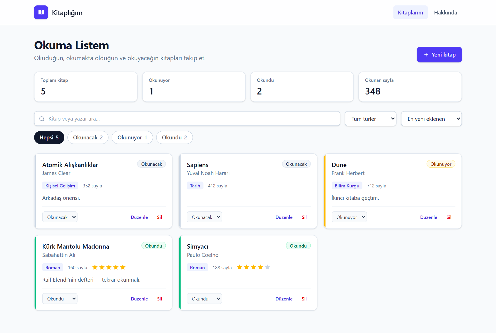
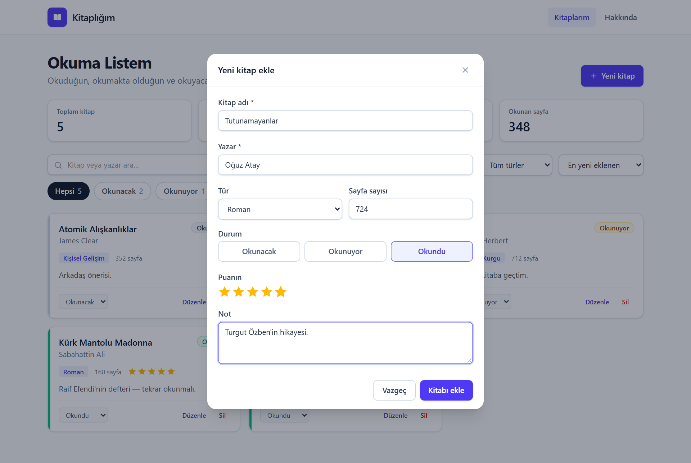
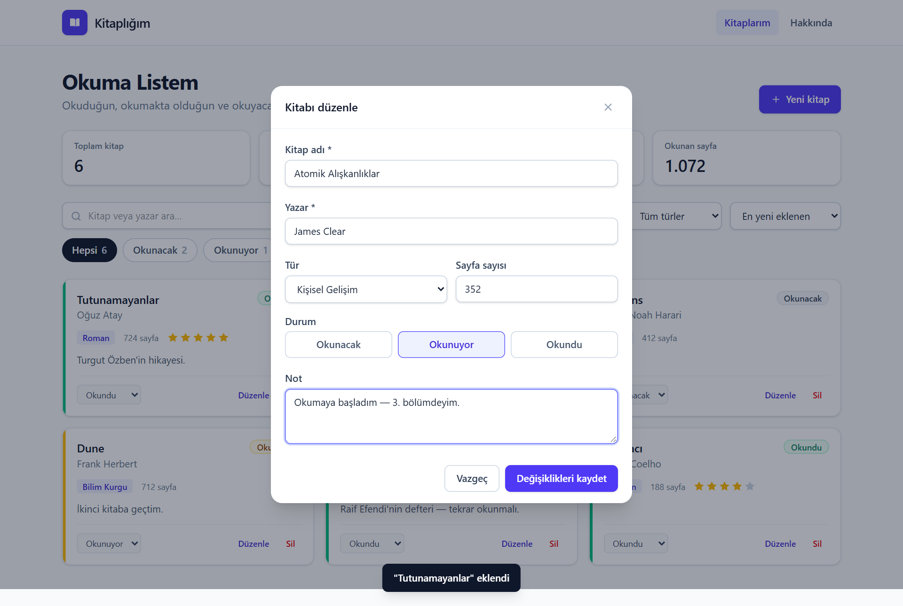
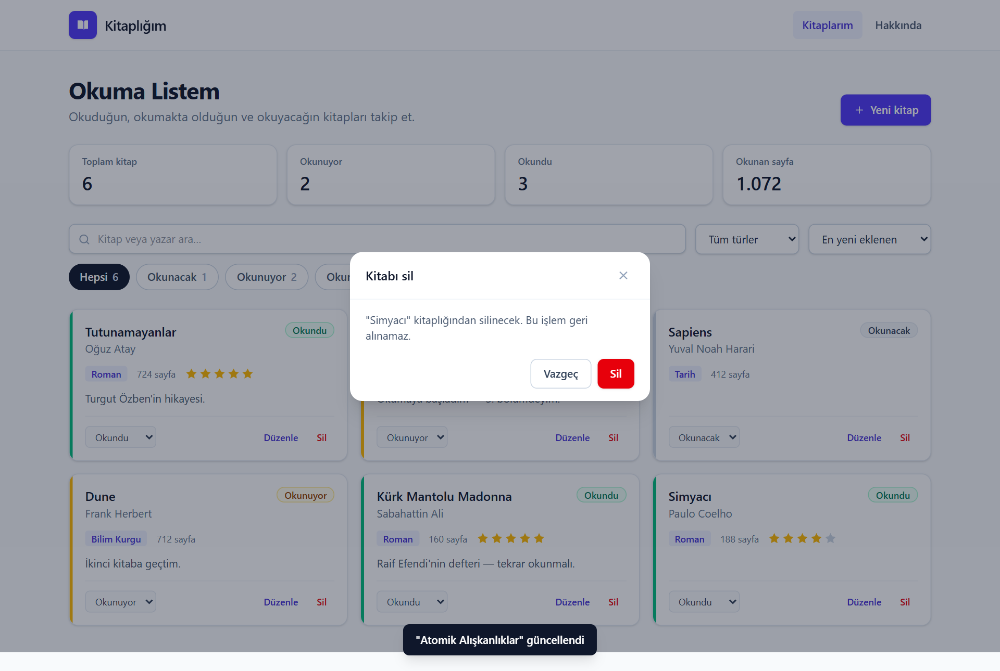
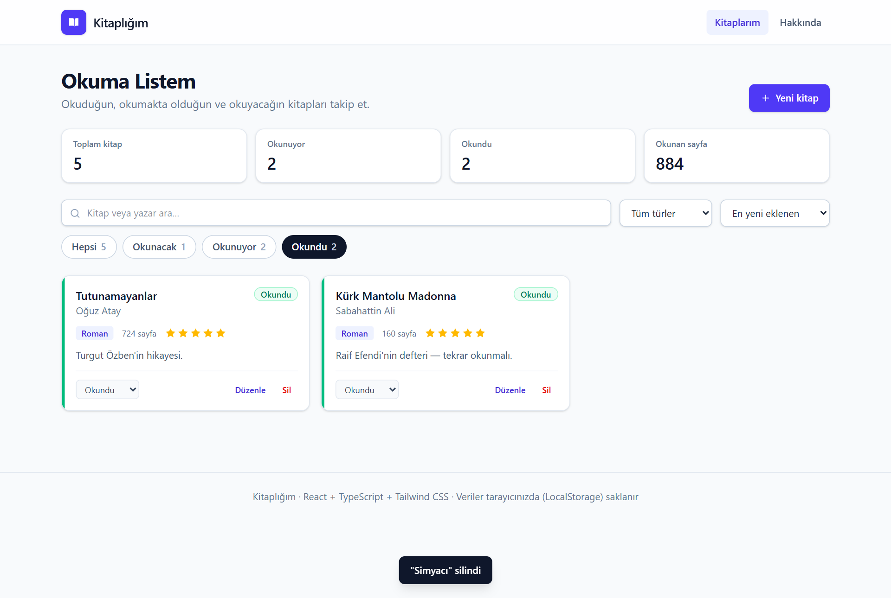
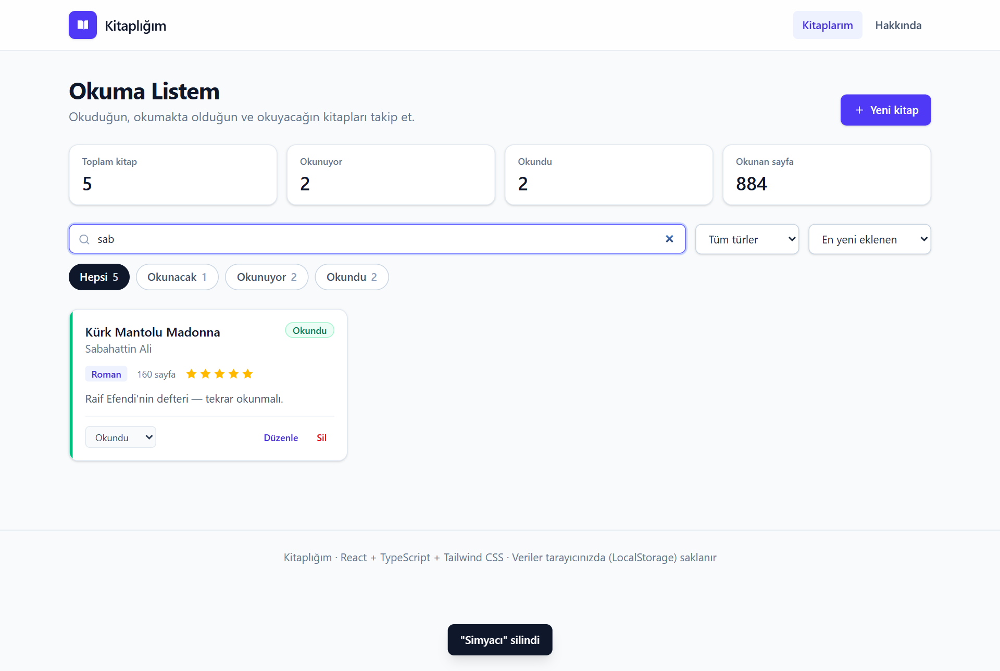
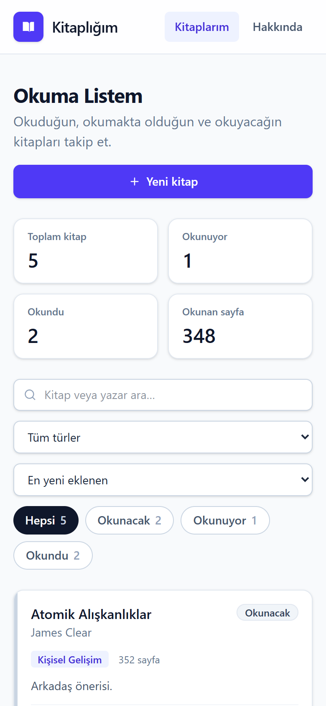

# Kitaplığım — Okuma Listesi

Okuduğun, okumakta olduğun ve okuyacağın kitapları takip etmeni sağlayan bir web uygulaması.
**Web Geliştirme; JavaScript** eğitimi proje yönergesine göre **React** ile geliştirilmiştir ve dört temel işlemi içerir: **Ekle, Listele, Güncelle, Sil.**



🔗 **Canlı demo:** _(Netlify'a yüklendikten sonra buraya eklenecek)_

## Özellikler

| İşlem | Nasıl? |
|---|---|
| **Ekle** | "Yeni kitap" butonu → ad, yazar, tür, sayfa sayısı, durum, puan ve not. Form doğrulaması vardır. |
| **Listele** | Kitaplar kart görünümünde; istatistik kutuları, arama (kitap/yazar), durum sekmeleri, tür filtresi ve sıralama. |
| **Güncelle** | "Düzenle" ile tüm bilgileri değiştir veya karttaki menüden durumu tek tıkla güncelle. |
| **Sil** | "Sil" → onay penceresi → kitap kaldırılır. |

- Veriler tarayıcının **LocalStorage** alanında saklanır; sayfa yenilense de kaybolmaz.
- İlk açılışta 5 örnek kitap gösterilir.
- Mobil uyumlu (responsive) tasarım, klavye ile kapatılabilen (Esc) pencereler.

## Kullanılan Teknolojiler

- [React 19](https://react.dev) + [TypeScript](https://www.typescriptlang.org)
- [Vite 8](https://vite.dev) (geliştirme sunucusu ve derleme)
- [Tailwind CSS 4](https://tailwindcss.com)
- LocalStorage (veri saklama)

## Kurulum

Gereksinim: [Node.js](https://nodejs.org) 20.19+ (geliştirme: v24.19.0)

```bash
git clone <repo-adresi>
cd kitapligim
npm install
npm run dev
```

Tarayıcıda **http://localhost:5173** adresini aç.

| Komut | Açıklama |
|---|---|
| `npm run dev` | Geliştirme sunucusu |
| `npm run build` | Tip kontrolü + `dist/` klasörüne üretim derlemesi |
| `npm run preview` | Derlenmiş sürümü yerelde önizle |

## Netlify'a Yükleme

Projede `netlify.toml` hazırdır (build komutu `npm run build`, yayın klasörü `dist`).

**Yol 1 — GitHub ile (önerilen):** Netlify → *Add new site → Import an existing project* → GitHub reposunu seç → ayarlar otomatik okunur → *Deploy*.

**Yol 2 — Sürükle bırak:** `npm run build` çalıştır, oluşan `dist` klasörünü [app.netlify.com/drop](https://app.netlify.com/drop) sayfasına sürükle.

## Klasör Yapısı

```
kitapligim/
├── public/                 # favicon
├── src/
│   ├── components/         # Header, BookCard, BookForm, FilterBar, StatsBar, Modal, ConfirmDialog, StarRating, EmptyState, Toast
│   ├── pages/              # HomePage (kitap listesi), AboutPage (hakkında)
│   ├── interfaces/         # Book.ts — TypeScript tipleri
│   ├── hooks/              # useBooks.ts — CRUD işlemleri + LocalStorage senkronu
│   ├── utils/              # storage.ts, sampleBooks.ts
│   ├── App.tsx             # Sayfa geçişi (hash tabanlı)
│   ├── main.tsx
│   └── index.css           # Tailwind
├── screenshots/            # Ekran görüntüleri
├── index.html
├── netlify.toml
└── vite.config.ts
```

## Ekran Görüntüleri

| Kitap ekleme | Düzenleme |
|---|---|
|  |  |

| Silme onayı | Durum filtresi |
|---|---|
|  |  |

| Arama | Mobil |
|---|---|
|  |  |
